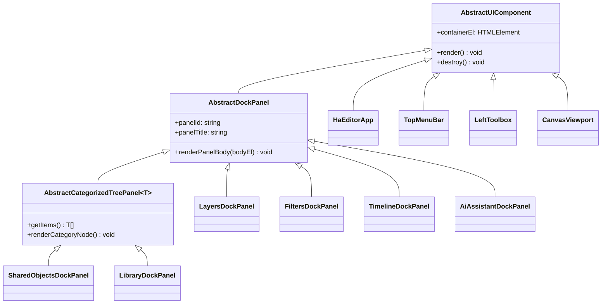

# HAEditor Architecture & Testing Guide

## 1. Component Hierarchy

Every UI panel, tool, and state store in **HAEditor** inherits from a clean abstract base class hierarchy:

### 1.1 State & Context Management (`src/state/editor-state.ts`)
- `AbstractObservableState` -> `EditorSessionState`:
  - Manages `hasOpenCanvas`, `canvasId`, `activeLayerId`, `activeToolId`, `lastVectorToolId`, `lastRasterToolId`, `editMode` (`"none" | "in_place" | "isolated_tab"`), `openSharedObjectTabs`, GIMP clipboard & named buffers, and filter repeat history.
  - Automatically synchronizes `activeToolId` and the `LeftToolbox` (`VECTOR / INKSCAPE` vs. `RASTER / GIMP`) whenever `activeLayerId` changes.

### 1.2 Interactive Editor Tools (`src/tools/abstract-editor-tool.ts`)
- `AbstractEditorTool`:
  - `AbstractVectorShapeTool` -> `RectShapeTool`, `CircleShapeTool`, `EllipseShapeTool`, `PolygonShapeTool`, `StarShapeTool`, `LineShapeTool`
  - `VectorSelectTransformTool`, `VectorPathTool`, `VectorTextTool`
  - `AbstractRasterStrokeTool` -> `BrushTool`, `PencilTool`, `AirbrushTool`, `EraserTool`
  - `AbstractRasterFillTool` -> `FloodFillTool`, `GradientFillTool`
  - `AbstractSelectionTool` -> `RectSelectTool`, `EllipseSelectTool`

---

## 2. Direct Node `require()` & NPM Module Integration (No Bundler Needed)

`HAEditor` runs directly in NW.js without Webpack:
- Consumes `@nexustools/hacanvas` and `@nexustools/aitooling` via `package.json` (`node_modules/@nexustools/*`).
- `tsconfig.json` compiles TypeScript sources from `src/**/*.ts` into `./dist/src` using CommonJS modules.
- `index.html` resolves `dist/src/haeditor-app.js` via Node's native `require()` and calls `bootstrapHaEditor(window, projectRoot)`.

---

## 3. Automated NW.js `<webview>` & Engine Test Harness (`testrunner/`)

Running `npm test` compiles the project and launches `nw testrunner`, which executes:
1. **Engine & Unit Test Suites (`src/tests/HaEditorSuites.ts`)**:
   - `AbstractClassHierarchiesAndRegistries` (GIMP filters, multi-format codecs, 17 editor tools)
   - `GimpFiltersAndInkscapeVectors` (all 6 GIMP filters + Inkscape Boolean CSG operations)
   - `SharedObjectCategorizationAndModes` (slash-path category trees, In-Place coordinate mapping, Isolated Tab mode)
   - `OSConfigAndReusableSharedObjectLibrary` (`config.json` persistence, `.haso` library export/import)
   - `AdobeIllustratorAiImport` (legacy PostScript `.ai` and modern PDF/FlateDecode `.ai` with OCG layers)
   - `LmStudioAiAssistantAndTooling` (`http://localhost:1234` default, non-reasoning + `low`/`medium`/`max` reasoning payloads, `parsePartialJson`, all 26 AI tools)
   - `GimpUndoRedoClipboardAndTransforms` (`Ctrl+Z` / `Ctrl+Y` undo/redo, clipboard copy/paste, image rotation, context-sensitive tool switching)
2. **Live `<webview>` DOM Integration Tests (`testrunner/index.html`)**:
   - Blank startup & HACanvas Splash Screen validation (`#ha-splash-screen`, `#btn-splash-new-canvas`, `#btn-splash-open-file`, `0` initial tabs/layers/shared objects, and `×` close buttons on tabs)
   - Categorized Shared Object creation modal & folder tree rendering
   - In-Place Shared Object editing banner, Isolated Tab switching, and `×` tab closing
   - OS Config Library saving, GIMP filter application, and custom right-click context menu
   - GIMP File Menu (`Open...`, `Open as Layers...`, `Import` submenu) & interactive File Browser dialog
   - End-to-end HTTP SSE streaming with the 3-level Brain dropdown (`Low`, `Medium`, `Max`) and live tool call rendering
   - Full 15-menu GIMP menubar hover auto-opening, nested submenu hover switching, and `Ctrl+Z` / `Ctrl+Y` undo/redo
   - Context-sensitive Left Toolbox switching between Vector and Raster layers
