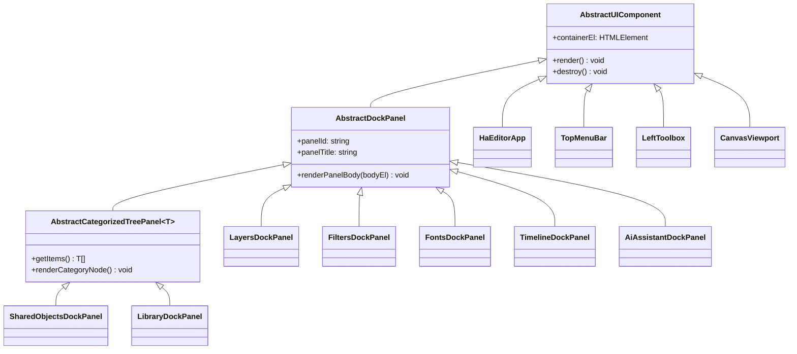

# HAEditor Architecture & Testing Guide

## 1. Modular 1-Class-Per-File Source Architecture

Both **HAEditor** (`workspace/haeditor/src/`) and **HACanvas** (`hacanvas/src/`) follow a strict **1 class / 1 tool / 1 filter / 1 transition / 1 importer / 1 exporter per `.ts` file** modular directory layout while preserving clean barrel exports (`index.ts`, `abstract-editor-tool.ts`, `editor-state.ts`, etc.).

### 1.1 `workspace/haeditor/src/` Directory Structure
```text
src/
├── haeditor-app.ts                               # Main application shell (HaEditorApp)
├── state/
│   ├── abstract-observable-state.ts              # AbstractObservableState (pub/sub observer base)
│   ├── editor-session-state.ts                   # EditorSessionState (central state & HaCanvasAiContext)
│   └── editor-state.ts                           # State barrel re-export
├── tools/
│   ├── base/
│   │   ├── abstract-editor-tool-base.ts          # AbstractEditorTool (root tool base class)
│   │   ├── abstract-raster-stroke-tool.ts        # AbstractRasterStrokeTool
│   │   ├── abstract-raster-fill-tool.ts          # AbstractRasterFillTool
│   │   ├── abstract-selection-tool.ts            # AbstractSelectionTool
│   │   └── abstract-vector-shape-tool.ts         # AbstractVectorShapeTool
│   ├── vector-select-transform-tool.ts           # VectorSelectTransformTool (V)
│   ├── vector-deform-tool.ts                     # VectorDeformTool (K - bend curves & move nodes)
│   ├── rect-shape-tool.ts                        # RectShapeTool (U)
│   ├── circle-shape-tool.ts                      # CircleShapeTool (O)
│   ├── ellipse-shape-tool.ts                     # EllipseShapeTool (L)
│   ├── polygon-shape-tool.ts                     # PolygonShapeTool (Y)
│   ├── star-shape-tool.ts                        # StarShapeTool (S)
│   ├── line-shape-tool.ts                        # LineShapeTool (I)
│   ├── vector-path-tool.ts                       # VectorPathTool (P)
│   ├── vector-text-tool.ts                       # VectorTextTool (T)
│   ├── brush-tool.ts                             # BrushTool (B)
│   ├── pencil-tool.ts                            # PencilTool (N)
│   ├── airbrush-tool.ts                          # AirbrushTool (A)
│   ├── eraser-tool.ts                            # EraserTool (E)
│   ├── flood-fill-tool.ts                        # FloodFillTool (G)
│   ├── gradient-fill-tool.ts                     # GradientFillTool (D)
│   ├── rect-select-tool.ts                       # RectSelectTool (R)
│   ├── ellipse-select-tool.ts                    # EllipseSelectTool (C)
│   ├── editor-tool-registry.ts                   # EditorToolRegistry
│   └── abstract-editor-tool.ts                   # Tools barrel re-export
├── ui/
│   ├── abstract-ui-component.ts                  # AbstractUIComponent
│   ├── top-menu-bar.ts                           # TopMenuBar (15-menu GIMP/Inkscape menubar)
│   ├── left-toolbox.ts                           # LeftToolbox (context-sensitive tool grid & swatches)
│   ├── top-menu-and-toolbar.ts                   # Menu & toolbox barrel re-export
│   ├── canvas-viewport.ts                        # CanvasViewport (pan, zoom, rulers, filter cache, overlays)
│   ├── context-menu.ts                           # ContextMenuManager
│   ├── modal-dialog.ts                           # ModalDialogManager
│   ├── js-code-ide-editor.ts                     # JsCodeIdeEditor (syntax-highlighted JS IDE with Ctrl+Click docs)
│   └── panels/
│       ├── abstract-dock-panel.ts                # AbstractDockPanel
│       ├── abstract-categorized-tree-panel.ts    # AbstractCategorizedTreePanel<T>
│       ├── layers-dock-panel.ts                  # LayersDockPanel (layer stack & attached filter badges)
│       ├── filters-dock-panel.ts                 # FiltersDockPanel (Immediate vs. Dynamic Attach filters + JS IDE)
│       ├── shared-objects-dock-panel.ts          # SharedObjectsDockPanel (sub-canvases & attached filter badges)
│       ├── library-dock-panel.ts                 # LibraryDockPanel (cross-project OS library browser)
│       ├── fonts-dock-panel.ts                   # FontsDockPanel (embedded TrueType/OpenType fonts)
│       ├── timeline-dock-panel.ts                # TimelineDockPanel (keyframes, Bezier curve editor, raster transitions)
│       └── ai-assistant-dock-panel.ts            # AiAssistantDockPanel (Multi-Provider AI Studio & 33 tools)
└── tests/
    ├── TestRunner.ts                             # TestRunner harness
    └── HaEditorSuites.ts                         # Comprehensive unit & integration test suites
```

---

## 2. Component Hierarchy

Every UI panel, tool, and state store in **HAEditor** inherits from a clean abstract base class hierarchy:



### 2.1 State & Context Management (`src/state/`)
- `AbstractObservableState` (`src/state/abstract-observable-state.ts`) -> `EditorSessionState` (`src/state/editor-session-state.ts`):
  - Manages `hasOpenCanvas`, `canvasId`, `activeLayerId`, `activeToolId`, `lastVectorToolId`, `lastRasterToolId`, `editMode` (`"none" | "in_place" | "isolated_tab"`), `editingObjectId` (for bypassing attached object filters during interactive drag/deform), `openSharedObjectTabs`, GIMP clipboard & named buffers, and filter repeat history.
  - Automatically synchronizes `activeToolId` and the `LeftToolbox` (`VECTOR / INKSCAPE` vs. `RASTER / GIMP`) whenever `activeLayerId` changes.

### 2.2 Interactive Editor Tools (`src/tools/`)
- `AbstractEditorTool` (`src/tools/base/abstract-editor-tool-base.ts`):
  - `AbstractVectorShapeTool` -> `RectShapeTool`, `CircleShapeTool`, `EllipseShapeTool`, `PolygonShapeTool`, `StarShapeTool`, `LineShapeTool`
  - `VectorSelectTransformTool`, `VectorDeformTool`, `VectorPathTool`, `VectorTextTool`
  - `AbstractRasterStrokeTool` -> `BrushTool`, `PencilTool`, `AirbrushTool`, `EraserTool`
  - `AbstractRasterFillTool` -> `FloodFillTool`, `GradientFillTool`
  - `AbstractSelectionTool` -> `RectSelectTool`, `EllipseSelectTool`

---

## 3. Direct Node `require()` & NPM Module Integration (No Bundler Needed)

`HAEditor` runs directly in NW.js without Webpack:
- Consumes `@nexustools/hacanvas` and `@nexustools/aitooling` via `package.json` (`node_modules/@nexustools/*`).
- `tsconfig.json` compiles TypeScript sources from `src/**/*.ts` into `./dist/src` using CommonJS modules.
- `index.html` resolves `dist/src/haeditor-app.js` via Node's native `require()` and calls `bootstrapHaEditor(window, projectRoot)`.

---

## 4. Automated NW.js `<webview>` & Engine Test Harness (`testrunner/`)

Running `npm test` compiles the project and launches `nw testrunner`, which executes:
1. **Engine & Unit Test Suites (`src/tests/HaEditorSuites.ts`)**:
   - `AbstractClassHierarchiesAndRegistries` (GIMP filters, multi-format codecs, 18 editor tools)
   - `GimpFiltersAndInkscapeVectors` (Immediate + Dynamic Non-Destructive GIMP filters on layers/objects/shared objects + Inkscape Boolean CSG & shape/line deformation)
   - `SharedObjectCategorizationAndModes` (slash-path category trees, In-Place coordinate mapping, Isolated Tab mode)
   - `OSConfigAndReusableSharedObjectLibrary` (`config.json` persistence, `.hacanvas` library export/import)
   - `AdobeIllustratorAiImport` (legacy PostScript `.ai` and modern PDF/FlateDecode `.ai` with OCG layers)
   - `LmStudioAiAssistantAndTooling` (`http://localhost:1234` default, non-reasoning + `low`/`medium`/`max` reasoning payloads, `parsePartialJson`, all 33 AI tools including `inspect_layer` with active filters, `inspect_animation_timeline` with curves/transitions, and `deform_vector_object` on shapes & lines)
   - `GimpUndoRedoClipboardAndTransforms` (`Ctrl+Z` / `Ctrl+Y` undo/redo, clipboard copy/paste, image rotation, context-sensitive tool switching)
2. **Live `<webview>` DOM Integration Tests (`testrunner/index.html`)**:
   - Blank startup & HACanvas Splash Screen validation
   - Categorized Shared Object creation modal & folder tree rendering
   - In-Place Shared Object editing banner, Isolated Tab switching, and `×` tab closing
   - OS Config Library saving, GIMP filter application (Immediate & Dynamic Attach), and custom right-click context menu
   - GIMP File Menu (`Open...`, `Open as Layers...`, `Import` submenu) & interactive File Browser dialog
   - End-to-end HTTP SSE streaming with the 3-level Brain dropdown (`Low`, `Medium`, `Max`) and live tool call rendering
   - Full 15-menu GIMP menubar hover auto-opening, nested submenu hover switching, and `Ctrl+Z` / `Ctrl+Y` undo/redo
   - Context-sensitive Left Toolbox switching between Vector and Raster layers
